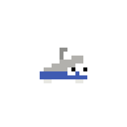

# Flick



The bot for the TechHOUNDS Discord server, named after our 2013 robot, [Flick](https://youtu.be/8Ls_uvX_NXE)!

Icon made by the wonderful [Bryce Castle](https://bcastle.net)!

## Commands
TODO

### Roulette

Run `;roulette 10` (or `/roulette bet:10`) and click **Red**, **Black**,
**Even**, or **Odd**. A win returns twice the stake, including the original
bet. Green 0 loses on all four choices. Bets must be positive whole-dollar
amounts within the player's balance. An unused menu expires without charging.

Everyone starts with **$50 in the server's first week of roulette**. At
**Sunday 12:00 a.m. America/New_York** (the start of Sunday), the new week starts
with **$100 per player**. Winnings do not carry over. New players joining in a
later week also start with $100. The server's first week is saved, so restarting
the bot cannot grant another first-week allowance. For the week beginning
October 18, 2026, the next cutoff is October 25, 2026 at 12:00 a.m. Eastern.

- `;roulettebalance`: check your current balance.
- `;rouletteleaderboard`: current standings, ordered by balance.
- `;rouletteleaderboard true`: most recent completed week with players.
- `;roulettechannel`: choose the current channel for automatic weekly standings
  (requires Manage Server).

These commands also support slash commands. Load the updated games extension
and run the existing admin `;sync` command to register them.

Standings include players who opened roulette or checked their balance that
week. Tied balances share a rank. Past weeks are retained. The weekly post
shows the top 15 and attaches a CSV with all registered players' final balances.
The bot needs View Channel, Send Messages, Embed Links, and Attach Files in the
chosen channel. Configure that channel once with `;roulettechannel`.

The bot checks for completed weeks every minute, including after restarting.
If it was offline at midnight, balances still use the new week immediately on
the next interaction, and missed standings are posted when it returns.
Without a configured channel, standings remain saved and can be requested
with the leaderboard command. Failed sends are retried. A crash between sending
a weekly announcement and saving its message ID can duplicate that announcement,
but a spin's stored result cannot charge or pay twice.

Balances are stored in `data/roulette.sqlite3`, or the path in `ROULETTE_DB`.
Docker Compose mounts a named volume at `/app/data` so redeploys retain the
database. Keep that volume when updating the bot. Run one bot process per
database. Do not commit database files or `.env`.

Run the roulette tests after installing `requirements.txt`:

```sh
python -m unittest discover -s tests -v
```
